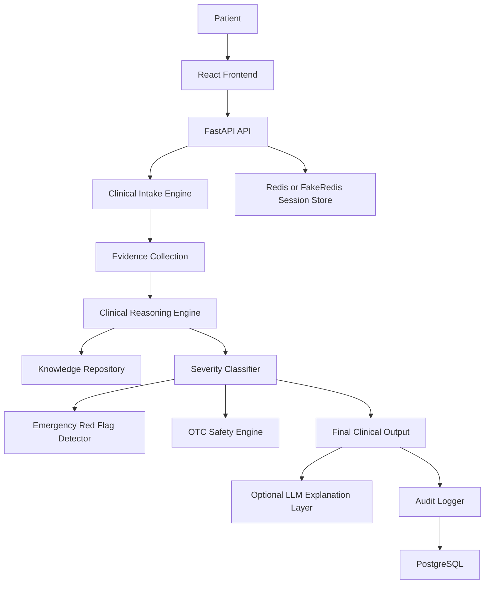

# AURA

AURA is an AI-powered Clinical Decision Support Platform focused on structured patient intake, deterministic clinical reasoning, emergency red flag detection, and explainable medical guidance.

AURA is not a chatbot and not a diagnosis tool. Patient safety is the highest priority. The LLM never makes medical decisions; it only helps translate already-determined results into patient-friendly language.

## Status

AURA is in active development toward a v1.0 production-quality milestone.

Current capabilities include:

- FastAPI backend with modular clinical engines
- React frontend built with Vite
- Deterministic intake, red flag, severity, OTC safety, and reasoning components
- Internal deterministic clinical explanation engine
- Adaptive clinical interview subsystem
- Data-driven medical knowledge repository
- Redis-backed sessions with local FakeRedis fallback
- PostgreSQL persistence and audit log models
- OpenAI, Gemini, and Ollama explanation orchestration
- Unit tests across safety, reasoning, sessions, API, and output assembly

## Safety Model

AURA follows a strict safety boundary:

- Deterministic engines decide emergency red flags.
- Deterministic engines decide severity.
- Deterministic engines perform clinical reasoning.
- Deterministic engines validate medication safety.
- The LLM only explains the final deterministic result.

The LLM must never downgrade urgency, override red flags, prescribe medication, or independently diagnose a patient.

## Architecture



More detail:

- [Project Brief](docs/PROJECT_BRIEF.md)
- [Architecture](docs/ARCHITECTURE.md)
- [Folder Structure](docs/FOLDER_STRUCTURE.md)
- [Setup Guide](docs/SETUP.md)
- [Deployment Guide](docs/DEPLOYMENT.md)
- [Roadmap](docs/ROADMAP.md)
- [Contributing Guide](CONTRIBUTING.md)

## Repository Layout

```text
AURA/
  app/                  FastAPI backend and clinical engines
  app/reasoning/        Deterministic clinical reasoning engine
  app/explanation/      Deterministic structured explanation engine
  app/interview/        Adaptive clinical interview engine
  frontend/             React and Vite client
  tests/                Backend unit tests
  alembic/              Database migration history
  datasets/             Dataset processing utilities
  docs/                 Project documentation
```

## Quick Start

Backend:

```powershell
cd C:\Users\jatin\Desktop\AURA
python -m venv .venv
.\.venv\Scripts\Activate.ps1
pip install fastapi uvicorn redis sqlalchemy asyncpg pydantic-settings httpx pytest pytest-asyncio
python -m uvicorn app.main:app --host 127.0.0.1 --port 8000
```

Frontend:

```powershell
cd C:\Users\jatin\Desktop\AURA\frontend
npm install
npm run dev
```

Open:

- Frontend: http://127.0.0.1:5173
- Backend health: http://127.0.0.1:8000/health

See [Setup Guide](docs/SETUP.md) for full environment details.

## Demo Media

Screenshots and demo media are tracked as documentation placeholders for now:

- `docs/assets/aura-landing.png`
- `docs/assets/aura-intake.png`
- `docs/assets/aura-result.png`
- `docs/assets/aura-demo.gif`
- `docs/assets/aura-demo.mp4`

See [docs/assets/README.md](docs/assets/README.md).

## Medical Disclaimer

AURA is a software project for clinical decision support workflows. It does not provide medical diagnoses and does not replace professional medical care. If symptoms may be urgent or life-threatening, users should contact emergency services or a licensed clinician immediately.
