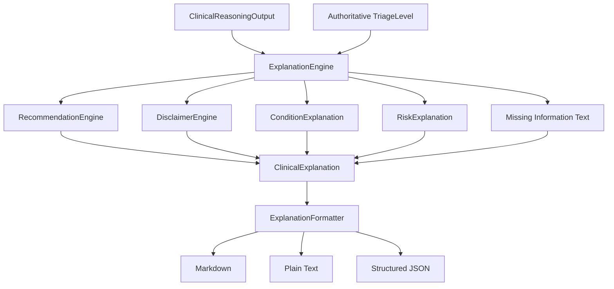
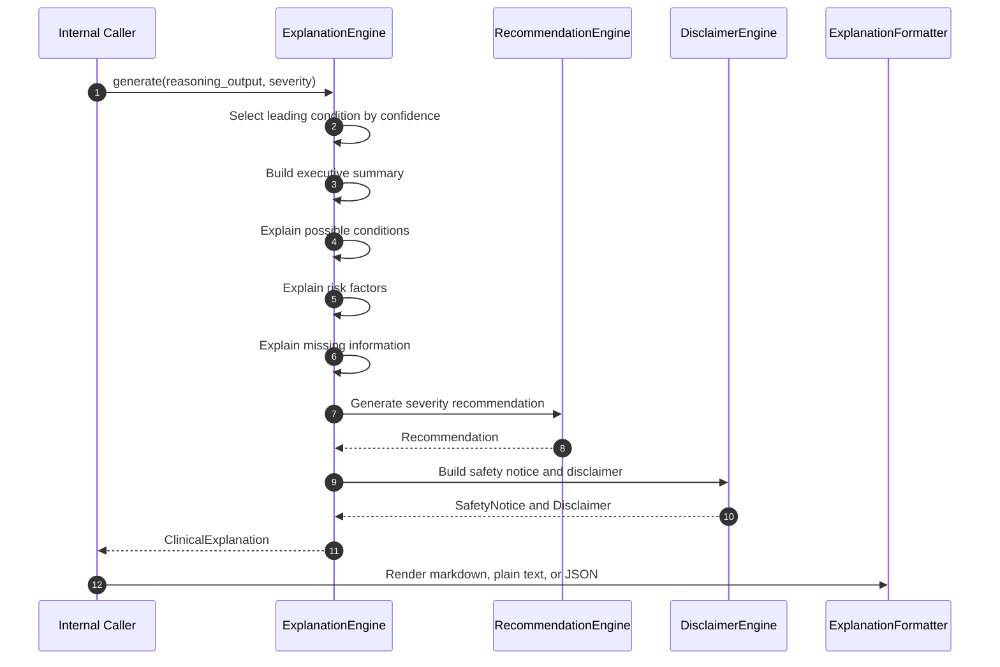

# Clinical Explanation Engine

The Clinical Explanation Engine is an internal deterministic subsystem for AURA.

It transforms `ClinicalReasoningOutput` into a structured, human-readable `ClinicalExplanation` suitable for future patient-facing reports.

It does not call:

- OpenAI
- Ollama
- Gemini
- Any LLM provider

The LLM may optionally rewrite this explanation later, but this package must always produce a complete explanation by itself.

## Package Layout

```text
app/explanation/
  __init__.py
  models.py
  explanation_engine.py
  explanation_templates.py
  formatter.py
  recommendation_engine.py
  disclaimer_engine.py
  README.md
```

## Safety Boundary

This package does not make clinical decisions.

It consumes:

- `ClinicalReasoningOutput` from `app/reasoning`
- Authoritative severity from `app.models.triage.TriageLevel`

It produces:

- Executive summary
- Possible condition explanations
- Risk factor explanations
- Missing information explanations
- Severity-based deterministic recommendations
- Safety notices
- Clinical disclaimer

## Architecture Diagram



## Sequence Diagram



## Usage

```python
from app.explanation import ExplanationEngine, ExplanationFormatter
from app.models.triage import TriageLevel

engine = ExplanationEngine()
formatter = ExplanationFormatter()

explanation = engine.generate(reasoning_output, TriageLevel.URGENT)
markdown = formatter.to_markdown(explanation)
plain_text = formatter.to_plain_text(explanation)
structured = formatter.to_json(explanation)
```

## Severity Examples

### Emergency

Input severity:

```python
TriageLevel.EMERGENCY
```

Generated recommendation:

```text
Seek Emergency Care Immediately
Call emergency services or go to the nearest emergency department now. Do not drive yourself if symptoms are severe.
```

Generated safety notice:

```text
Emergency Warning: This assessment indicates possible emergency-level symptoms. Seek emergency care immediately.
```

### Urgent

Input severity:

```python
TriageLevel.URGENT
```

Generated recommendation:

```text
Seek Prompt Medical Care
Contact a doctor, urgent care clinic, or local medical advice line today.
```

### Routine

Input severity:

```python
TriageLevel.ROUTINE
```

Generated recommendation:

```text
Schedule a Clinical Appointment
Schedule an appointment with a healthcare professional and monitor symptoms for changes.
```

### Self Care

Current code represents self-care as:

```python
TriageLevel.HOME_CARE
```

Generated recommendation:

```text
Self Care With Monitoring
Rest, stay hydrated, monitor symptoms, and seek care if symptoms worsen or new red flags appear.
```

The recommendation payload uses the display severity `SELF_CARE` while preserving the existing authoritative enum value `HOME_CARE`.

## Determinism Guarantees

The package uses only:

- Pydantic models
- Template strings
- Static severity mappings
- Existing deterministic reasoning output

No network calls, model calls, randomness, database access, Redis access, or API changes are introduced.

