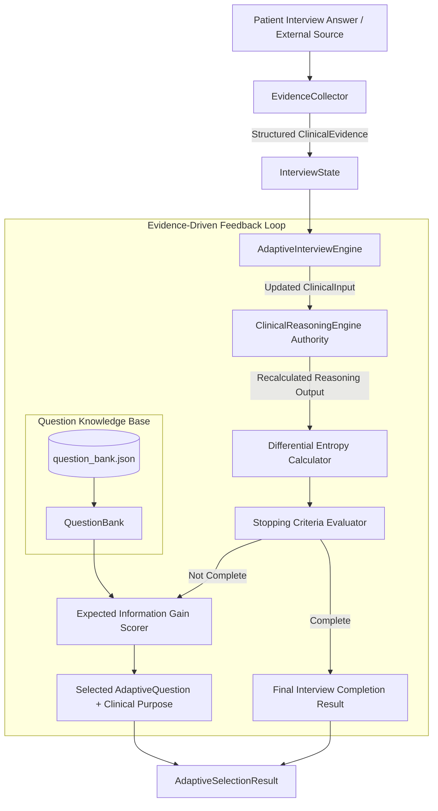
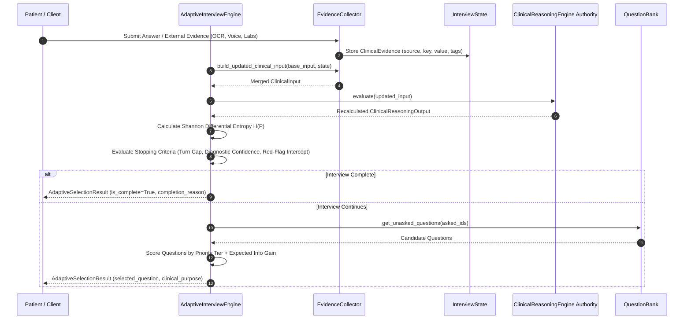

# Adaptive Clinical Interview Engine (`app/interview`)

The **Adaptive Clinical Interview Engine** is an evidence-driven, dynamic question selection subsystem. Building directly on top of the deterministic `ClinicalReasoningEngine`, it evaluates differential entropy reduction and expected information gain to dynamically select high-yield follow-up questions while treating all patient answers as structured clinical evidence.

---

## 🏛️ System Architecture Diagram



---

## 🔄 Multimodal Evidence Sequence Diagram



---

## 📊 Entropy & Information Gain Formulas

### 1. Shannon Differential Entropy
Given $K$ candidate conditions with confidence scores $c_1, c_2, \dots, c_K$:
$$p_i = \frac{c_i}{\sum_{j=1}^K c_j}$$
$$H(P) = -\sum_{i=1}^K p_i \log_2(p_i)$$

### 2. Expected Information Gain & Scoring
$$\text{Score}(Q) = \text{TierWeight}(Q) + \text{BaseGain}(Q) \cdot (1 + \text{RelevanceBonus}(Q))$$
where:
* **Tier Weights**:
  * `CRITICAL_RED_FLAG` = $10.0$
  * `DIFFERENTIAL_DISCRIMINATOR` = $5.0$
  * `MISSING_DATA_RECOVERY` = $3.0$
  * `SYMPTOM_REFINEMENT` = $1.0$
* **Relevance Bonus**: $+2.0$ if question targets the top differential candidate condition.

---

## 💡 Adaptive Selection Result Example

```json
{
  "selected_question": {
    "question_id": "Q_ACS_001",
    "text": "Does your chest pain or pressure radiate to your left arm, shoulder, neck, or jaw?",
    "input_type": "yes_no",
    "purpose": "Differentiate myocardial ischemia (ACS) from non-cardiac chest pain (GERD/Musculoskeletal).",
    "target_evidence_key": "chest_pain_radiation",
    "target_condition_ids": ["COND_001", "COND_020"],
    "priority_tier": "CRITICAL_RED_FLAG",
    "base_information_gain": 0.85
  },
  "selection_rationale": "Selected 'Q_ACS_001' (Priority Tier: CRITICAL_RED_FLAG) to Differentiate myocardial ischemia (ACS) from non-cardiac chest pain (GERD/Musculoskeletal).. Expected Information Gain: 0.85.",
  "expected_information_gain": 25.55,
  "differential_entropy": 1.4821,
  "is_complete": false,
  "completion_reason": null
}
```
