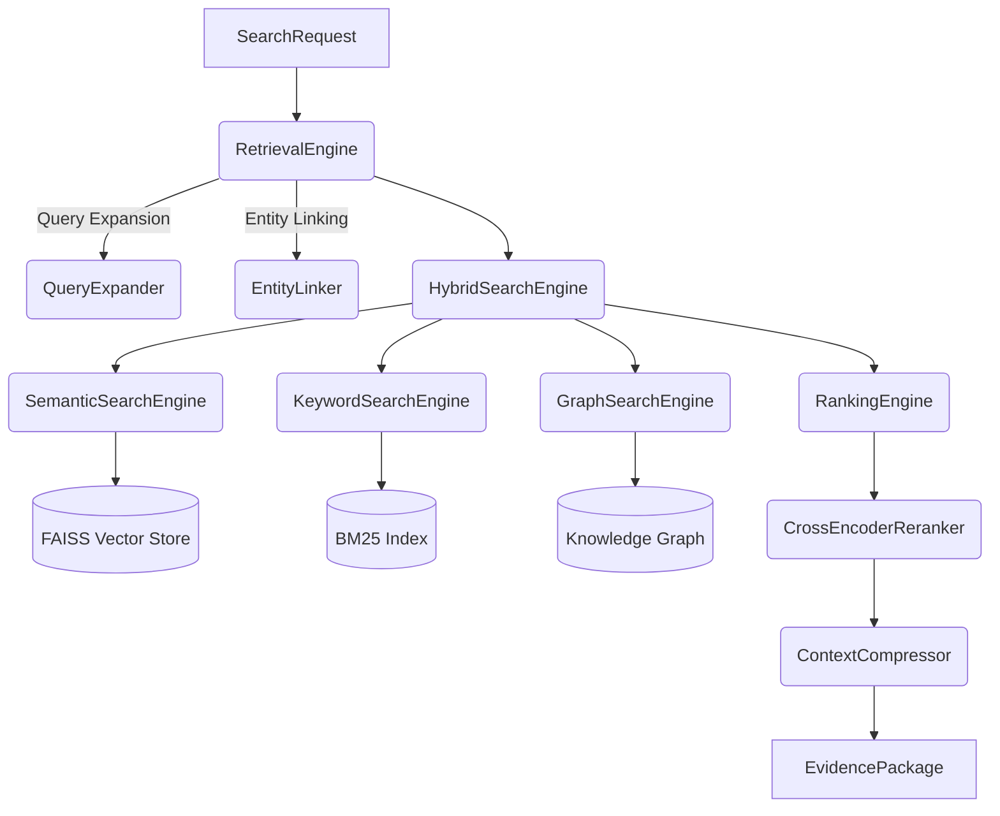

# Retrieval Engine

This module serves as the Enterprise Hybrid Retrieval Engine for the AURA platform. It is strictly deterministic and provides the infrastructure for Multi-Agent Workflows, RAG, and LLM Tool Calling.

## Architecture

