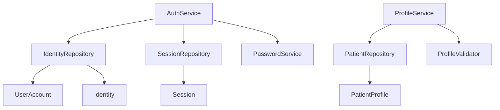

# Patient Management Subsystem

The `patients` package manages authenticated user identities and their associated clinical patient profiles. It introduces persistent identity into the AURA platform without altering core clinical logic.

## Architecture

The architecture separates Authentication Identity from Clinical Profile data to enable a one-to-many relationship (one authenticated `UserAccount` managing multiple `PatientProfile`s).

## Security Considerations

- **Hashing**: Passwords are mathematically hashed using Bcrypt (via passlib) with a unique salt per user. Plaintext passwords are NEVER persisted.
- **Abstract Persistence**: Identity and Profile domains interact solely through repository interfaces, ensuring database swaps (e.g. SQLite to PostgreSQL) can occur without refactoring the business layer.
- **Session Management**: Each login yields a secure UUID token bound to an expiration date. Sessions are validated upon subsequent requests and explicitly destroyed upon logout.

## Future Extension Points (Not Implemented)

This subsystem was heavily modularized to support future feature integrations:
- **OAuth2 & External Providers**: `AuthService` can be extended to accept tokens from Google Sign-In, Microsoft Authentication, or OpenID Connect without changing the `UserAccount` model.
- **Advanced Auth Flows**: The service layer can easily integrate Multi-factor Authentication (MFA), Email Verification, Password Resets, and Account Recovery mechanisms.
- **Database Backends**: The `Repository` interfaces have been designed to allow seamless migration to cloud databases or SQLAlchemy models.
