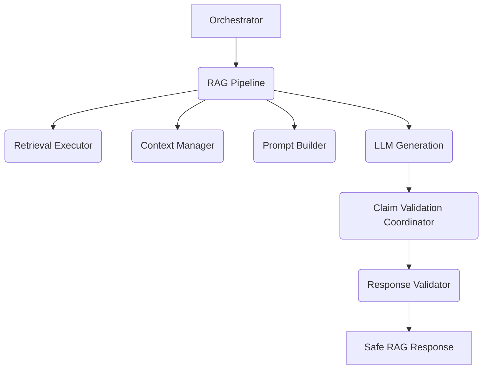

# AURA Clinical RAG & Medical Reasoning Engine

This module completely isolates Retrieval-Augmented Generation (RAG) logic from the Orchestrator. It acts as a safety pipeline to ensure the LLM strictly adheres to medical evidence and cannot invent unverified clinical claims.

## Architecture

## Features
- **Retrieval Abstraction:** Uses `KnowledgeRetrievalTool` and `RetrievalDecisionEngine` to decide if FAISS is needed.
- **Safety First:** The `ClaimValidatorCoordinator` strictly splits responses into individual medical assertions and verifies them against the FAISS context before allowing them through to the user.
- **Confidence Fusion:** Calculates true confidence combining FAISS precision, LLM reasoning, and validation rates.
