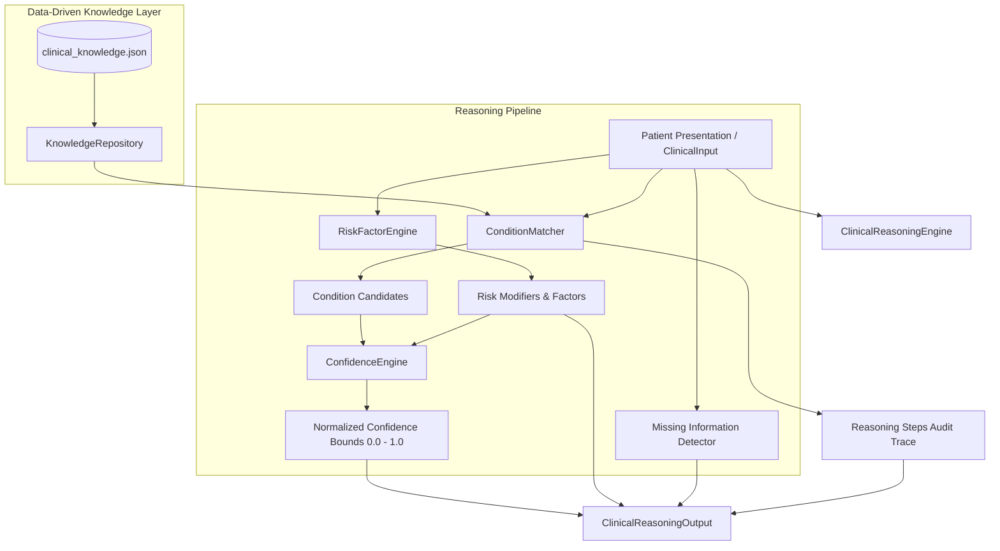
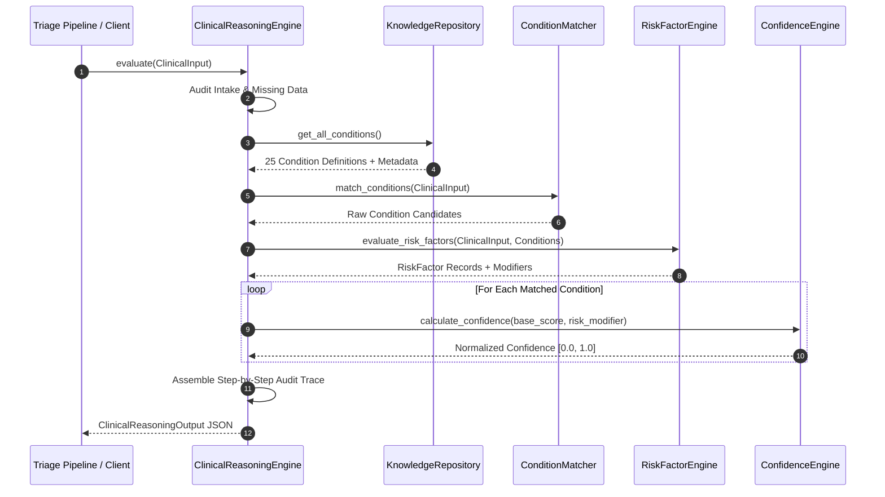

# Clinical Reasoning Engine (`app/reasoning`)

The **Clinical Reasoning Engine** is an internal, deterministic intelligence layer for the AURA medical triage platform. It produces transparent, explainable medical reasoning prior to LLM invocation, ensuring all severity and safety logic remains strictly deterministic.

---

## 🏛️ System Architecture Diagram



---

## 🔄 Execution Flow Diagram



---

## 📊 Derivation & Normalization Mathematics

Given:
* $S_{\text{base}} \in [0.0, 1.0]$: Primary and secondary symptom matching ratio.
* $\Delta R \in [0.0, 0.6]$: Cumulative additive modifier weight from patient demographic/chronic risk factors.
* $P_{\text{conflict}} = 0.2 \cdot N_{\text{conflicting}}$: Penalty for present contradicting symptoms.

### 1. Base Match Score
$$S_{\text{base}} = \max\left(0.0, \frac{2 \cdot N_{\text{primary\_matched}} + 1 \cdot \min(N_{\text{secondary\_matched}}, 3)}{2 \cdot N_{\text{primary\_req}} + 1 \cdot \min(N_{\text{secondary\_req}}, 3)} - P_{\text{conflict}}\right)$$

### 2. Normalized Confidence Clamping
$$\text{Confidence} = 
\begin{cases} 
0.0 & \text{if } S_{\text{base}} = 0.0 \\
\min\left(1.0, \max\left(0.0, S_{\text{base}} + 0.4 \cdot \Delta R\right)\right) & \text{otherwise}
\end{cases}$$

---

## 📁 Repository Data Schema (`clinical_knowledge.json`)

Each condition in the data-driven repository includes full clinical metadata and literature references:

```json
{
  "id": "COND_001",
  "name": "Acute Coronary Syndrome",
  "category": "Cardiovascular",
  "icd10_code": "I24.9",
  "description": "Acute myocardial ischemia or infarction causing chest pressure and systemic symptoms.",
  "primary_symptoms": ["chest pain", "chest tightness", "chest pressure"],
  "secondary_symptoms": ["shortness of breath", "dizziness", "nausea", "sweating", "left arm pain"],
  "conflicting_symptoms": ["runny nose", "sore throat", "rash"],
  "risk_modifiers": {
    "diabetes": 0.25,
    "hypertension": 0.2,
    "heart disease": 0.3,
    "age_over_65": 0.25
  },
  "references": [
    "AHA/ACC 2020 Clinical Practice Guidelines for Acute Coronary Syndromes",
    "ICD-10-CM Diagnosis Code I24.9"
  ]
}
```

---

## 💡 Engine Output Example

```json
{
  "possible_conditions": [
    {
      "name": "Acute Coronary Syndrome",
      "confidence": 0.88,
      "icd10_code": "I24.9",
      "category": "Cardiovascular",
      "supporting_symptoms": ["chest pain", "shortness of breath", "dizziness"],
      "conflicting_symptoms": [],
      "base_score": 0.7143,
      "risk_score_modifier": 0.45,
      "references": [
        "AHA/ACC 2020 Clinical Practice Guidelines for Acute Coronary Syndromes",
        "ICD-10-CM Diagnosis Code I24.9"
      ]
    }
  ],
  "risk_factors": [
    {
      "factor_name": "Elderly Age (>= 65)",
      "description": "Advanced age increases vulnerability to cardiovascular events, severe infections, and metabolic complications.",
      "risk_weight": 0.2,
      "affected_condition": "Multiple"
    },
    {
      "factor_name": "Diabetes Mellitus",
      "description": "Pre-existing diabetes impairs microvascular perfusion and immune function, worsening cardiovascular and infection outcomes.",
      "risk_weight": 0.25,
      "affected_condition": "Cardiovascular & Metabolic"
    }
  ],
  "missing_information": [
    {
      "field_name": "symptom_duration",
      "clinical_relevance": "Duration differentiates hyperacute emergencies (e.g. stroke, anaphylaxis) from chronic presentations.",
      "impact_on_reasoning": "Onset timing velocity could not be factored into acute condition weighting."
    }
  ],
  "reasoning_steps": [
    {
      "step_number": 1,
      "phase": "INTAKE_ANALYSIS",
      "description": "Received patient clinical presentation with 3 symptom tags and chief complaint.",
      "evidence": ["symptoms: ['chest pain', 'shortness of breath', 'dizziness']", "age: 68"]
    },
    {
      "step_number": 2,
      "phase": "MISSING_DATA_AUDIT",
      "description": "Evaluated input completeness. Identified 2 missing clinical parameters.",
      "evidence": ["symptom_duration", "symptom_severity"]
    },
    {
      "step_number": 3,
      "phase": "CONDITION_MATCHING",
      "description": "Evaluated symptom tags against 25 repository conditions. Matched 4 candidate conditions.",
      "evidence": ["Acute Coronary Syndrome (base_score=0.7143)", "Pulmonary Embolism (base_score=0.5714)"]
    },
    {
      "step_number": 4,
      "phase": "RISK_EVALUATION",
      "description": "Evaluated patient demographics and chronic conditions. Identified 2 risk factors.",
      "evidence": ["Elderly Age (>= 65) (+0.2)", "Diabetes Mellitus (+0.25)"]
    },
    {
      "step_number": 5,
      "phase": "SYNTHESIS",
      "description": "Derived normalized confidence scores bounded in [0.0, 1.0] for all matched conditions.",
      "evidence": ["Acute Coronary Syndrome: confidence=0.88"]
    }
  ],
  "evaluated_at": "2026-07-21T22:48:00Z"
}
```
