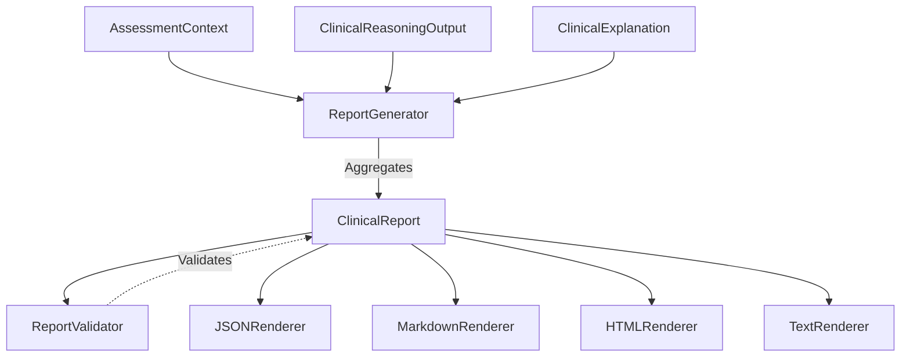
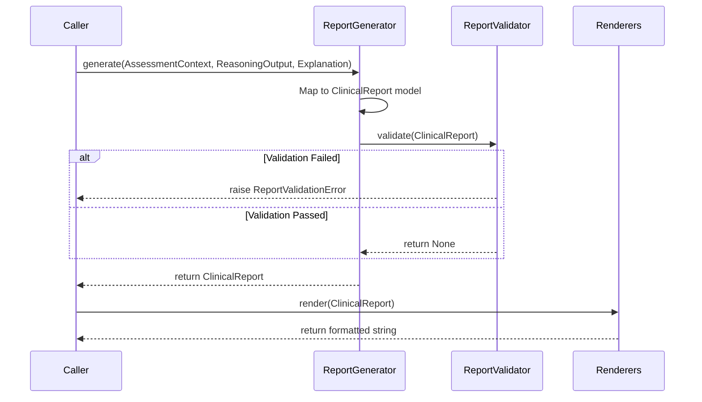

# Reporting Subsystem

The `reporting` package is a deterministic presentation layer that aggregates clinical data into a standardized `ClinicalReport` model. It serves as the single source of truth for PDF generation, Doctor Dashboards, FHIR export, Email Reports, Patient Timelines, and Analytics.

**CRITICAL RULE:** This module MUST NOT perform any reasoning, modify confidence scores, change recommendations, or call an LLM. It is strictly for presentation.

## Architecture

## Sequence

## Developer Guide

1. **Input Models**: Always pass immutable inputs to the generator. `AssessmentContext` should abstract away internal system state.
2. **Adding Renderers**: To add a new renderer (e.g. PDF), implement the `ReportRenderer` interface found in `app/reporting/renderers/base.py`.
3. **Validation Rules**: If a new clinical rule is introduced (e.g., specific missing information must be present for severe cases), add it to `ReportValidator`.
4. **Versioning**: Always increment `AURA_VERSION` and engine versions appropriately in `ReportGenerator` instantiation.

## Sample Report Use Cases
- **EMERGENCY**: Must include safety notices. Usually sent via high-priority JSON webhooks.
- **URGENT**: Fast-tracked to Doctor Dashboard HTML views.
- **ROUTINE**: Sent via Markdown to patient timelines.
- **HOME CARE**: Used in patient-facing Email text reports.
