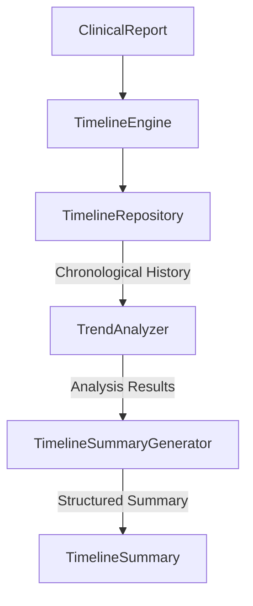
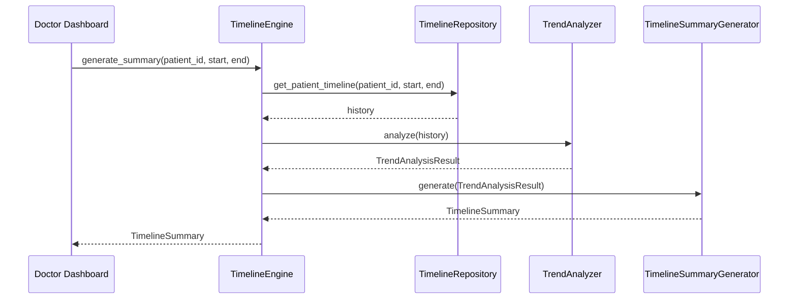

# Patient Timeline Subsystem

The `timeline` package is a deterministic engine that aggregates historical `ClinicalReport` instances into a longitudinal patient timeline. It provides capabilities to track trends in symptoms, severity, and conditions over time, powering long-term clinical decision support.

**CRITICAL RULE:** This module MUST NOT perform any clinical reasoning, modify historical reports, or utilize LLMs. All trend analysis is strictly rule-based and deterministic.

## Architecture

## Rendering Flow (Future Usage)

## Developer Guide

1. **Adding Assessments**: The `TimelineEngine.add_assessment(patient_id, report)` method should be called immediately after a `ClinicalReport` is fully validated and rendered by the `reporting` subsystem.
2. **Standardized Severity**: Severity strings are automatically normalized to the `SeverityLevel` enum for deterministic comparison (e.g. `EMERGENCY` > `URGENT`).
3. **Repository Extensibility**: The `TimelineRepository` is an abstract interface. Currently, `InMemoryTimelineRepository` is used, but it can be seamlessly swapped for a PostgreSQL or FHIR-backed implementation in the future.

## Future Capabilities (Placeholders)

The subsystem is designed to serve as the foundation for the following future features:
- **Assessment Comparison**: Side-by-side diffing of clinical values across two specific reports.
- **Recovery Score**: Deterministic derivation of a patient's overall recovery trajectory.
- **Symptom Timeline**: Visual graphing endpoints for individual symptom persistence over time.
- **Medication Timeline**: Tracking when medications were introduced or stopped across assessments.
- **Lab Timeline**: Trend lines for historical lab results.
- **Vitals Timeline**: Trend lines for historical vitals (e.g., blood pressure, heart rate).
