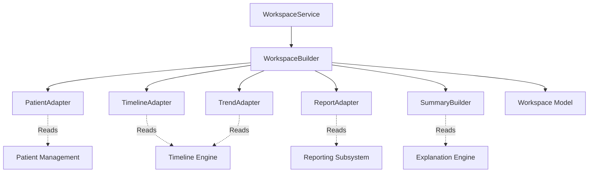

# Clinical Workspace Subsystem

The `workspace` package serves as the primary orchestration layer for compiling clinician-facing data views. It aggregates read-only data from the Patient, Timeline, Reporting, and Explanation subsystems into a unified `Workspace` model.

**CRITICAL RULE:** This module MUST NOT perform any clinical reasoning, modify historical data, or utilize LLMs. It is strictly an aggregation and projection layer.

## Architecture & Data Flow

## Developer Guide

1. **Building the Workspace**: Always use the `WorkspaceService.build_workspace()` public method. It accepts a `patient_id` alongside the explicit `current_report` and `current_explanation`.
2. **Missing History**: The workspace is designed to be highly resilient. If a patient has no timeline history, the adapters gracefully return empty lists and generic structures without raising exceptions.
3. **Adapter Standardization**: Every adapter relies on a single public `adapt()` method to map disparate source models into embedded Workspace schemas.

## Future Extension Points (Placeholders)

The `WorkspaceActions` object defaults to `False` for all current capabilities. Future PRs will integrate these endpoints:
- **Assessment Comparison**: Launch side-by-side diffing tools directly from the UI.
- **Doctor Notes**: A module allowing the clinician to append mutable private notes to the immutable workspace instance.
- **Follow-up Plans**: Creating scheduled tasks triggered by specific workspace trends.
- **Care Pathway Visualization**: A graph representation of the patient's expected journey.
- **PDF / FHIR Export**: Orchestrating downstream systems to export the active Workspace.
