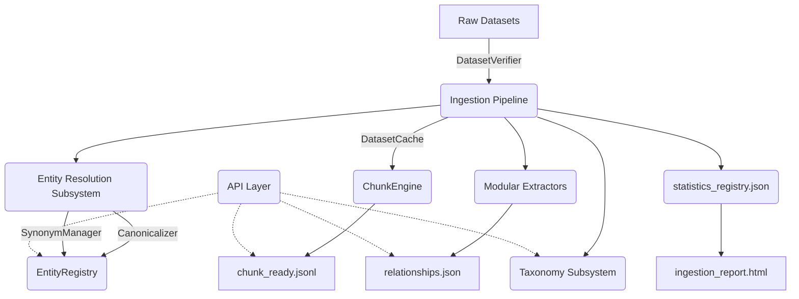
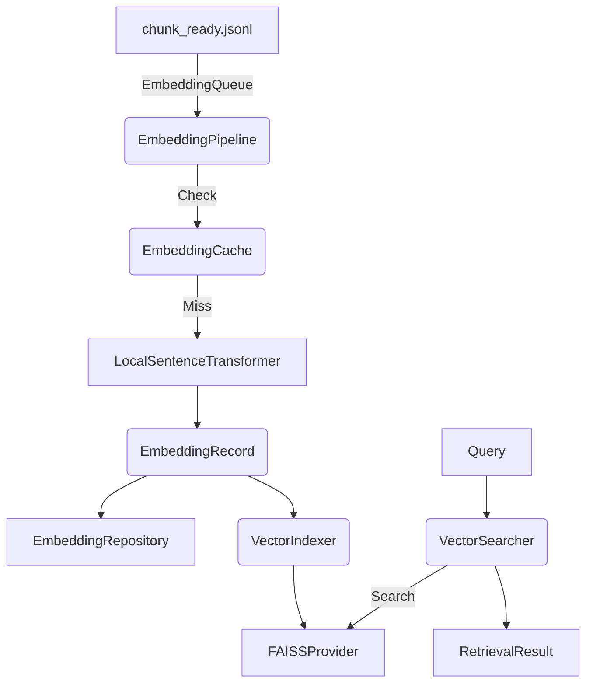

# AURA Knowledge Platform v2 Datasets

Welcome to the central repository for AURA's Knowledge Platform datasets. This deterministic, LLM-free data layer enforces SOLID principles and serves as the single source of truth.

## Architecture Blueprint



## Dataset Specifications

- **Manifests**: Strictly adhere to the 27-field `DatasetManifest` defined in `app/knowledge/datasets/manifest.py`. Must include `checksum_sha256` and a valid `publisher`.
- **Chunking**: Uses deterministic `ChunkEngine` without LLM calls. Supports Sentence, Paragraph, Semantic, and Medical Section strategies.
- **Relationships**: Processed independently via Modular Extractors (`DiseaseExtractor`, `DrugExtractor`, etc.).
- **Entity Resolution**: Canonicalization enforces immutable AURA entity IDs via `app/knowledge/entities/registry.py`.
- **Taxonomy**: Deterministic hierarchical organization found in `app/knowledge/taxonomy/hierarchy.py`.

## Adding a New Dataset

1. Place raw data in `raw/` directory.
2. Ensure publisher is valid (`DatasetPriorityManager` limits to WHO, CDC, NICE, NIH, etc.).
3. Run the ingestion pipeline to generate normalized records, extract relationships, assign AURA entity IDs, and chunk text.
4. Verify updates to `statistics_registry.json` and review the generated `ingestion_report.html`.

## Semantic Retrieval Infrastructure (Phase 4C)

The Vector Intelligence Platform transforms chunks into dense vector embeddings and manages their scalable retrieval via decoupled interfaces.

### Folder Structure

```
app/knowledge/
├── embeddings/
│   ├── models.py       # EmbeddingMetadata, EmbeddingRecord, Statistics
│   ├── manager.py      # EmbeddingModelManager
│   ├── provider.py     # LocalSentenceTransformerProvider
│   ├── queue.py        # EmbeddingQueue
│   ├── pipeline.py     # Incremental EmbeddingPipeline
│   ├── cache.py        # EmbeddingCache
│   └── repository.py   # EmbeddingRepository
└── vectorstore/
    ├── models.py       # RetrievalResult, VectorStatistics
    ├── strategies.py   # SimilarityStrategy (Cosine, DotProduct, L2)
    ├── interfaces.py   # IndexProvider, VectorStore
    ├── faiss_provider.py # FAISSProvider implementation
    ├── store.py        # VectorStoreImpl
    ├── repository.py   # VectorRepository
    ├── indexer.py      # VectorIndexer (Versioning)
    └── searcher.py     # VectorSearcher
```

### Architecture Pipeline


