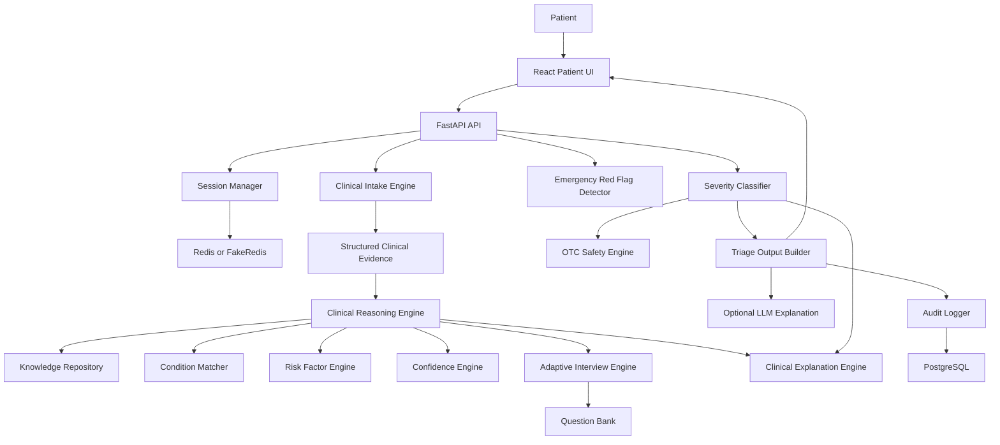
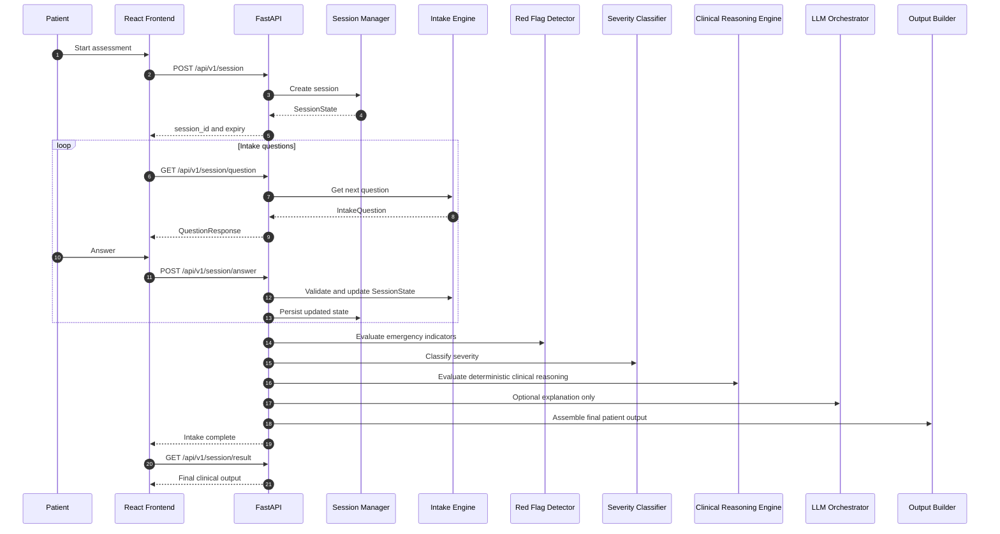
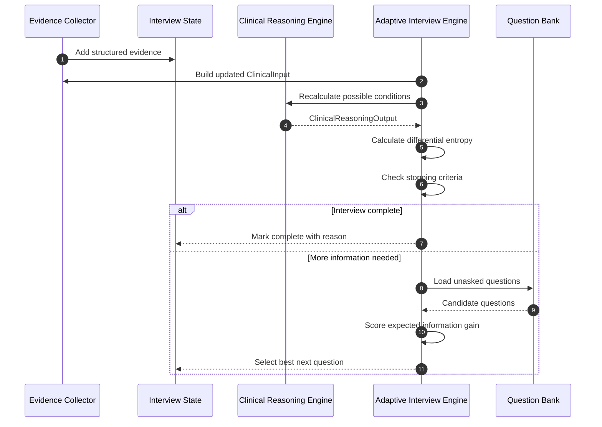

# AURA Architecture

## Overview

AURA is organized around deterministic clinical engines and an optional LLM explanation layer.

The backend is built with FastAPI. The frontend is built with React and Vite. Runtime state is stored in Redis when available, with an in-memory FakeRedis fallback for local development. Audit and reporting data are modeled for PostgreSQL through SQLAlchemy and Alembic.

## High-Level Architecture

## Request Flow

## Adaptive Interview Flow

## Clinical Reasoning Engine

Location: `app/reasoning/`

Responsibilities:

- Load structured clinical knowledge
- Match symptoms against condition definitions
- Apply demographic and chronic-condition risk factors
- Calculate normalized confidence scores
- Track supporting and conflicting evidence
- Report missing information
- Produce step-by-step reasoning traces

The reasoning engine is deterministic and does not call an LLM.

## Adaptive Clinical Interview Engine

Location: `app/interview/`

Responsibilities:

- Store structured clinical evidence
- Merge evidence into `ClinicalInput`
- Use reasoning output to estimate uncertainty
- Select high-value follow-up questions
- Stop when sufficient confidence, red flag interception, turn limits, or low information gain are reached

## Clinical Explanation Engine

Location: `app/explanation/`

Responsibilities:

- Transform `ClinicalReasoningOutput` into structured human-readable explanation
- Summarize leading possible condition without diagnosing
- Explain supporting and conflicting findings
- Explain deterministic risk factors
- Explain missing information
- Generate severity-based recommendations
- Generate safety notices and mandatory disclaimers
- Render Markdown, plain text, and structured JSON

The explanation engine is deterministic and does not call an LLM.

## API Surface

Current API routes are mounted under `/api/v1`:

- `POST /session` creates a session
- `GET /session/question` returns the next intake question
- `POST /session/answer` records an answer and may trigger triage
- `GET /session/result` returns the final triage output

The backend also exposes:

- `GET /health`

## Persistence

AURA currently models:

- `triage_sessions`
- `triage_audit_logs`

Redis is used for active session state. PostgreSQL is used for durable audit and reporting data.

## Safety Boundary

The output builder may include LLM-generated explanation text, but it must not allow LLM output to alter:

- Triage level
- Red flag outcomes
- Crisis resource injection
- Medication safety validation
- Final severity authority
