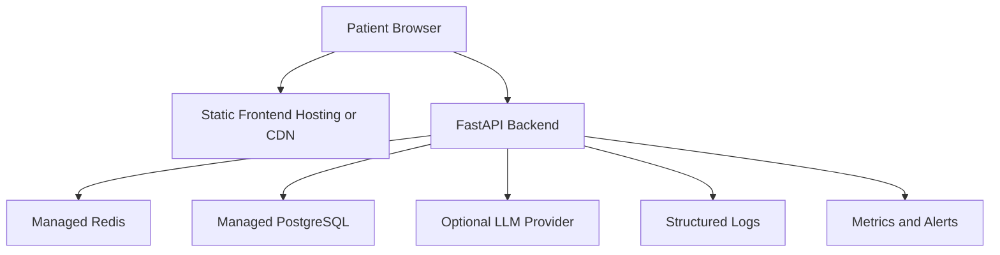

# Deployment Guide

## Deployment Goals

AURA should be deployed with patient safety, observability, and clear failure behavior as first-class requirements.

The LLM layer must remain optional. If LLM calls fail, deterministic triage output should still be available through fallback behavior.

## Recommended Production Architecture



## Backend Deployment

Recommended runtime:

- Python 3.11 or newer
- FastAPI
- Uvicorn or Gunicorn with Uvicorn workers
- Managed PostgreSQL
- Managed Redis

Example command:

```bash
uvicorn app.main:app --host 0.0.0.0 --port 8000
```

For production, prefer a process manager or platform-native service definition.

## Frontend Deployment

Build the frontend:

```bash
cd frontend
npm ci
npm run build
```

Deploy `frontend/dist` to static hosting.

Configure API routing so frontend requests to `/api/v1` reach the FastAPI backend.

## Environment Variables

Required or recommended variables:

```text
DATABASE_URL=
REDIS_URL=
LLM_PROVIDER=
LLM_MODEL=
LLM_API_KEY=
LLM_TIMEOUT_SECONDS=
LLM_MAX_TOKENS=
OLLAMA_BASE_URL=
```

Do not commit real secrets.

## Database Migrations

Run migrations as a deployment step:

```bash
alembic upgrade head
```

Migration execution should be idempotent and separated from normal request serving.

## Health Checks

Use:

```text
GET /health
```

Expected response:

```json
{"status":"healthy"}
```

## Logging and Monitoring

Production deployment should include:

- API request logs
- Triage pipeline failure logs
- LLM timeout and fallback metrics
- Red flag evaluation audit events
- Database connection metrics
- Redis connection metrics
- Error rate alerts

Avoid logging PHI. Audit logs should contain only clinically necessary structured data and should be reviewed for privacy risk.

## Security Checklist

Before public deployment:

- Add CORS policy appropriate to deployment domain
- Add rate limiting
- Add request size limits
- Review PHI handling
- Secure environment variables
- Enforce HTTPS
- Add dependency scanning
- Add CI checks for tests and linting
- Validate emergency resource behavior by region

## Current Deployment Gaps

Before v1.0 production deployment, add:

- Pinned backend dependencies
- Dockerfile or platform-specific deploy config
- Alembic environment configuration if missing
- CI pipeline
- Production CORS configuration
- Error tracking
- Monitoring dashboard

